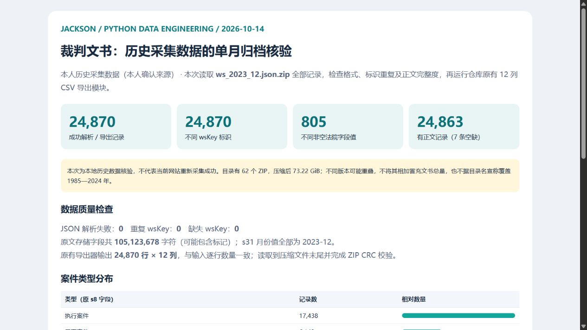
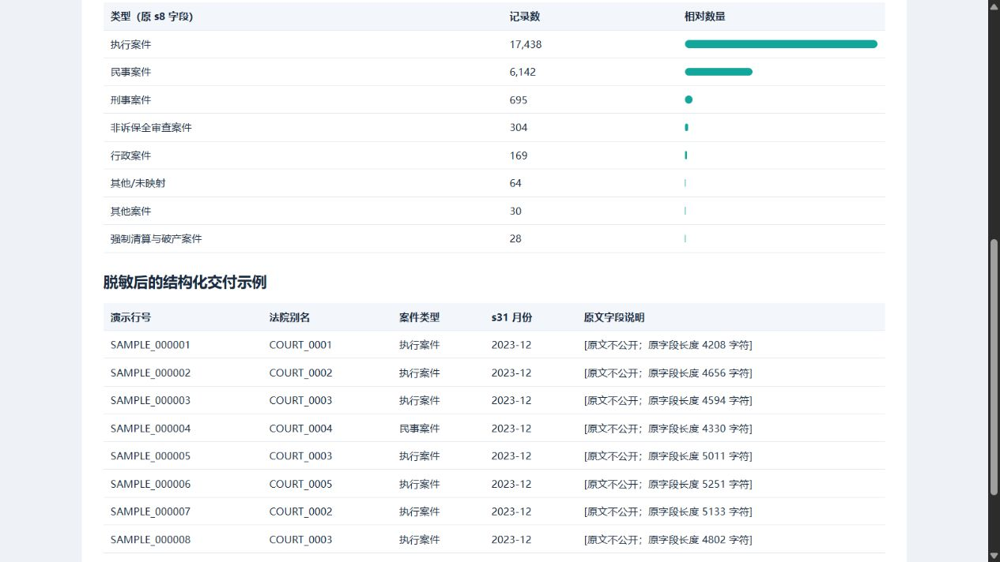

# Complex Website Data Extraction & Protocol Analysis

**A Python case study in converting a complex, session-based document website into structured, resumable data collection.**

The project targets China Judgments Online. Its engineering focus is request/response protocol analysis, session handling, hierarchical task partitioning, checkpoint recovery and consistent JSONL/CSV output.

## Client problem and delivery

| Challenge | Implementation in this repository |
| --- | --- |
| Browser requests contain encoded/encrypted parameters | Dedicated request encoding and response decoding functions |
| Data is partitioned by date, province and court | Hierarchical traversal and task-level progress tracking |
| Long tasks may stop or encounter response errors | Checkpoints, bounded retries and error-state handling |
| Raw records use inconsistent field names | A normalized schema and CSV export utility |
| Handover must be inspectable | Source code, operating notes and an offline demonstration |

## Historical collection audit — 14 October 2026



The owner identifies the local archives as their own historical collection. This run independently audited **one entire archive, `ws_2023_12.json.zip`**, rather than recollecting records from the live website:

| Measured check | Result |
| --- | ---: |
| Parsed JSON records | 24,870 |
| Distinct nonempty `wsKey` identifiers | 24,870 |
| Invalid JSON / duplicate IDs / missing IDs | 0 / 0 / 0 |
| Distinct nonempty court-field values | 805 |
| Records with nonempty `qwContent` | 24,863 (7 empty) |
| Original exporter output | 24,870 rows, 12 columns |

The archive was read to its end, including ZIP CRC validation. The stored `s31` values all fall in December 2023. This does not prove official coverage or present-day website access. A separate directory inventory found **62 ZIP files occupying 73.22 GiB**; overlapping versions mean their sizes or old line counts must not be converted into a unique document total. The folder name is not proof of 1985–2024 coverage.



Inspect the [20-row de-identified preview](docs/portfolio/historical-evidence/deidentified-preview.csv), [audit metrics and archive hash](docs/portfolio/historical-evidence/verification.json), and [inventory scope](docs/portfolio/historical-evidence/inventory-summary.json). The public preview replaces court names with aliases and withholds titles, parties, case numbers, source identifiers and full text. CSV `judge_date` contains the source `s31` month for this audit adapter, not the original full date. The existing exporter ran on the de-identified records; output reconciliation is local row-count validation, not an official collection-completeness claim.

To audit an authorized local archive without publishing its raw contents:

```powershell
python scripts/audit_local_archive.py "PATH_TO_ARCHIVE.zip" --out "LOCAL_AUDIT_OUTPUT"
```

No source archive, original judgments, personal identifiers or authentication/session material is included in the evidence bundle.

## Reproducible synthetic demonstration


```powershell
python -m venv .venv
.\.venv\Scripts\python.exe -m pip install pycryptodome
.\.venv\Scripts\python.exe scripts/portfolio_demo.py
```

This runs the repository's crypto helpers and CSV exporter against **synthetic fixtures**. It checks request encoding, encrypted-response decoding, and tabular export without logging in or contacting the source site. Open `docs/portfolio/demo.html` for the report. These local checks do not demonstrate current website access, collection speed or production coverage.

## Current implementation map

| Path | Purpose |
| --- | --- |
| `site_wenshu/crawler_wenshu.py` | Main crawler, field normalization, date/province/court traversal and checkpoints |
| `site_wenshu/utils/wenshu_crypto.py` | Request encoding and response decryption |
| `site_wenshu/utils/account_pool.py` | Session/account state management |
| `site_wenshu/utils/wenshu_auth.py` | Authentication helper implementation |
| `site_wenshu/tools/manual_login.py` | Legacy browser login helper; despite its filename, it contains automated login/CAPTCHA handling |
| `site_wenshu/tools/export_csv.py` | JSONL-to-CSV conversion and reconciliation output |
| `site_wenshu/archive_and_debug/` | Historical diagnostic scripts, not the supported entry point |

The current crawler imports **curl_cffi**. Older notes discussing `tls_client` describe previous experiments and should not be treated as the current dependency or startup guide.

## Preparing a live deployment

Install dependencies from `site_wenshu/requirements.txt` in an isolated environment, and install the Playwright browser only if the selected workflow needs it:

```powershell
python -m pip install -r site_wenshu/requirements.txt
python -m playwright install chromium
```

Before running `python site_wenshu/crawler_wenshu.py`, review the source-specific configuration and constants: date range, output filenames, local proxy, request rates, session inputs and access requirements. This is a developer-oriented project, not a one-command hosted service. Legacy diagnostic scripts should not be run blindly.

Login helpers now read local account values from `WENSHU_USERNAME`, `WENSHU_PASSWORD`, `WENSHU_PHONE_NUMBER` and, where used, `WENSHU_COUNTRY_CODE`. Do not commit real account values, cookies or session files. Some helpers require additional review before use. A client engagement must define the permitted sources, authorized account access and applicable access limits; this portfolio does not promise unrestricted access or universal CAPTCHA/WAF bypass.

For an existing JSONL export:

```powershell
python -c "from site_wenshu.tools.export_csv import jsonl_to_csv; jsonl_to_csv('input.jsonl', 'output.csv')"
```

## Deliverable schema

The exporter produces columns such as `case_name`, `court_name`, `case_code_ori`, `case_type`, `publish_date`, `judge_date`, `content`, `target_count` and `doc_id`. Dataset contents and permitted fields should be agreed before collection; example portfolio data is fictional.

## What this case study demonstrates

Protocol debugging, source-specific Python automation, task partitioning, failure recovery and structured data delivery. Current live availability and a client's exact scope require a separate feasibility check. No client identity, collection volume, uptime or success-rate claim is inferred from the presence of code.

[Historical Chinese notes](docs/legacy-readme.zh-CN.md) · [Technical investigation notes](site_wenshu/doc/wenshu_reverse_and_crawler_guide.md)
